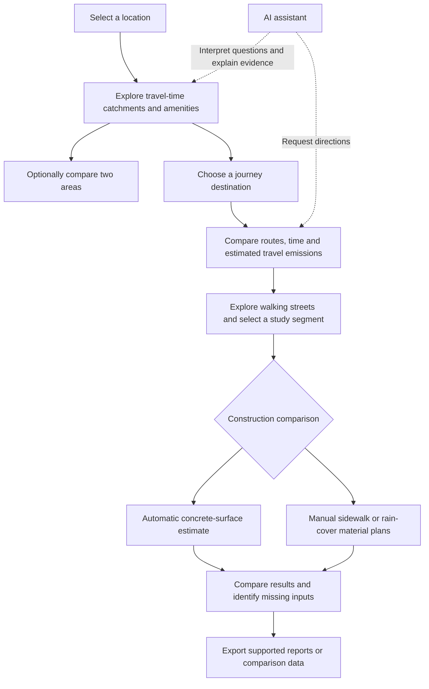

# ABSO — Accessibility and Low-Carbon Planning

ABSO is a Kuala Lumpur-focused hackathon prototype that helps developers and planners explore accessibility, compare travel emissions, and assess material scenarios for sidewalks and rain covers.

**Selected theme: PLANET — Green Transport.**

The central question is: **How can developers plan better-connected communities while comparing lower-carbon travel and construction options?**

## Problem and users

A facility can be nearby without being conveniently reachable. Journey time, access to everyday amenities, travel emissions and construction materials also need different kinds of evidence.

- **Developers and planners:** explore connections and compare options before further investigation or investment.
- **Residents:** potential beneficiaries of more convenient access and lower-carbon travel choices.
- **Hackathon reviewers:** follow a map-based demonstration with visible assumptions and data limitations.

This is a preliminary screening and scenario-comparison tool, not an engineering approval or a measurement of realised carbon savings.

## System workflow



### 1. Select a location

Search for a place, choose a map point or revisit a saved bookmark. The selected location becomes the study origin.

### 2. Analyse accessibility

Choose a travel mode, time budget and amenity categories. The map displays a modelled reachable area and returned facilities such as restaurants, schools, hospitals and transport stops. The comparison feature supports exploring two areas.

This answers: **What can people reach from this location?** Returned facilities are not necessarily an exhaustive inventory, and proximity does not establish safe or wheelchair-accessible access.

### 3. Compare journeys

Select an origin and destination. Available modes include walking, cycling, driving and public transport, subject to routing coverage and API access.

Compare route distance, estimated duration and supported operational-emissions scenarios. Route geometry is displayed when supplied by the routing provider. Transit summaries include boarding and alighting stops and combined walking distances.

This answers: **How do the available travel options compare?**

### 4. Explore possible improvements

Inspect streets along a walking route and select a segment for further study. Route length can populate the proposed comparison length; dimensions remain editable assumptions.

The route length is not proof that the entire route needs new construction. A missing map feature does not prove a sidewalk, crossing or roof is absent. Route-step screening does not establish construction suitability, ownership or approval.

### 5. Compare construction materials

| Mode | Inputs | Results and scope |
| --- | --- | --- |
| Automatic estimate | Length, width, slab thickness and optional material prices | Reference concrete-surface quantities and carbon for two plans; material cost when prices are supplied |
| Manual comparison | Listed materials, quantity units, quantities, carbon factors, factor sources and unit prices | Carbon and cost for the listed materials in Option A and Option B |

Automatic calculations use:

```text
Surface area = length × width
Concrete volume = surface area × thickness
Material carbon = quantity × carbon factor in matching units
Material cost = quantity × unit price in matching units
Reduction (%) = (baseline carbon − alternative carbon) / baseline carbon × 100
```

Automatic mode covers concrete surfacing only. Rain-cover materials, supports, foundations, reinforcement, installation and other components require appropriate additional inputs in Manual. A percentage reduction for concrete is not a whole-project reduction.

Manual quantities are user-entered. Changing the route length does not automatically recalculate manual material quantities. Incomplete rows produce missing-data notices or known-material subtotals rather than a complete estimate. Compare equivalent functions, service lives, units and lifecycle boundaries.

### 6. Ask the AI assistant

Examples:

- “Show me the area around KL Sentral.”
- “What restaurants are near Pavilion Bukit Bintang?”
- “How can I travel from MRT Merdeka to LaLaport?”
- “Why is the material carbon lower for Option B?”

The server sends the question, recent conversation and available map context to the configured AI provider. The response can contain a validated map action:

- **Focus:** show one area and clear the previous chat destination.
- **Nearby:** run an amenity/catchment lookup.
- **Route:** resolve endpoints, fetch directions and draw available route geometry.

The frontend executes these actions through map services and displays the returned evidence. The chatbot's destination is separate from the Sustainability destination. General questions can receive conversational answers without a map action.

AI explanations can be mistaken; matched locations, provider results and assumptions remain important. Temporary provider errors can still occur despite a limited retry.

### 7. Save and export

Settings supports saving, revisiting and removing favourite places. Personal budget tags can be assigned and used to filter bookmarks. These tags are not verified venue prices or an automatic price-based restaurant search.

Bookmarks and preferences are stored in the current browser's local storage, not a shared account. Use the available export controls for analysis reports and construction-comparison data.

## Data and limitations

| Component | Current basis | Important limitation |
| --- | --- | --- |
| Map and walking/cycling/driving directions | Mapbox integration | Modelled routes, not live GPS guidance or a pedestrian safety survey |
| Public transport directions | Google Routes | Provider estimates depend on matched endpoints and available routing data |
| Amenities | App place-search services, including fallback data where used | Check the displayed source; fallback/curated data is not a verified live inventory |
| Travel carbon | Reference factors and user assumptions; Malaysian grid factors for supported electricity scenarios | Some factors are non-Malaysian references, not local operator measurements |
| Automatic construction carbon | Concrete reference scenarios | Concrete surface only; not a locally verified specification or full lifecycle assessment |
| Manual construction cost/carbon | User-provided material data | Missing quantities, factors or prices prevent complete totals |
| Budget bookmarks | User-selected tags | Personal organisation, not actual venue price verification |

Travel emissions and construction emissions are separate comparisons. The app does not automatically prove mode shift, carbon payback, flood risk or the suitability of a proposed structure.

## Local development

The current application uses React, Vite and a Node.js API layer in `server.js`. The Vite development plugin mounts the API handlers; a Python backend is not required for this version.

1. Install a recent Node.js LTS release and npm.
2. Install dependencies:

   ```powershell
   npm install
   ```

3. If `.env` does not exist, copy `.env.example` to `.env`. Preserve an existing configuration.
4. Configure the services you intend to use:

   | Variable | Purpose |
   | --- | --- |
   | `AI_PROVIDER` | `gemini` or `openai` |
   | `AI_API_KEY` | Credential for the selected AI provider |
   | `AI_MODEL` | Model available to that provider/project |
   | `GOOGLE_API_KEY` | Google routing/place services; separate from the AI credential |
   | `MAPBOX_API_KEY` | Mapbox token used by the map integration |

   API access, restrictions, billing and quota must match the services enabled on the relevant project. Do not commit `.env` or expose credentials in screenshots.

5. Start the application:

   ```powershell
   npm run dev
   ```

   Open the local address printed by Vite. After changing server credentials, stop the process with `Ctrl+C`, restart it and refresh the browser.

6. Check production compilation:

   ```powershell
   npm run build
   ```

   A production deployment must also serve the API endpoints; uploading only the static build does not supply the backend integrations.

## Suggested demo flow

1. Introduce the PLANET / Green Transport problem.
2. Select a KL location and show its travel-time catchment and nearby amenities.
3. Set a journey, such as MRT Merdeka to LaLaport, and check the matched places.
4. Compare available travel modes, time and estimated carbon.
5. Inspect a walking segment and compare concrete-surface or manually entered construction plans.
6. Ask AI to explain an available result and show an export.

Use actual returned results during the demo. Explain unavailable data rather than presenting assumptions as measured outcomes.

## Main code locations

- `src/App.jsx` — application state, panels and chat/map coordination.
- `server.js` — provider requests and API handlers.
- `src/features/map/` — map interactions, geocoding and place services.
- `src/features/ai/` — chatbot client and interface.
- `src/features/sustainability/` — journey emissions and construction comparisons.
- `src/features/sustainability/factors.json` — reference transport factors.
- `src/features/sustainability/malaysia-grid.json` — Malaysian electricity-grid factor metadata.
- `src/features/settings/` — browser bookmarks and preferences.
- `src/features/export/` — analysis-report export.

## AI outages and offline material references

For Gemini, set `AI_FALLBACK_MODEL` to a model accessible to the same project. Temporary server errors, rate/quota responses or a timeout trigger one additional attempt using that model; without a configured fallback, the primary model is retried. Shared project quota or provider outages can affect both models. Restart the dev server after changing `.env`.

Sustainability includes a **Material references ? available without AI** panel. Its bundled concrete factors and comparison calculators remain available when chat fails. Fetching a new route still needs the routing service; dimensions and material data can be entered manually.

### Repeated chat requests

The server reloads `.env` values that it manages; explicit process-environment overrides retain priority. Restart once after updating the server code. Gemini models returning 429 or server errors are skipped for 60 seconds on subsequent calls; a 404 triggers a five-minute cooldown. The other configured model is used when available. If all configured models are cooling down, the app reports this without sending more provider requests. This is not a guarantee of unlimited usage: project quota and provider availability still apply.
